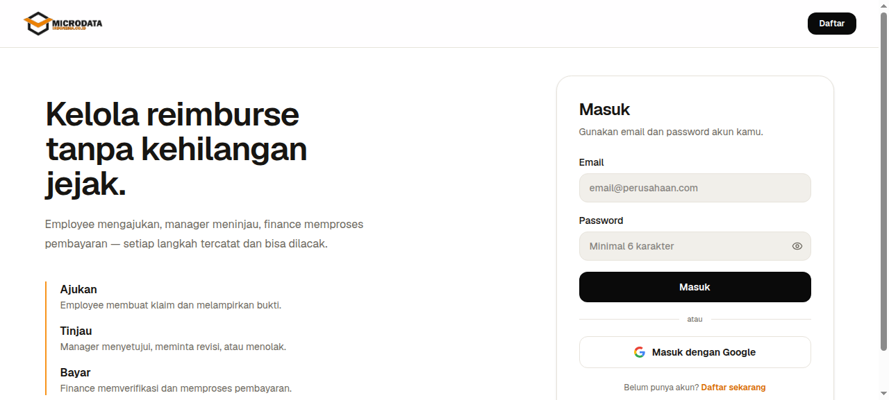
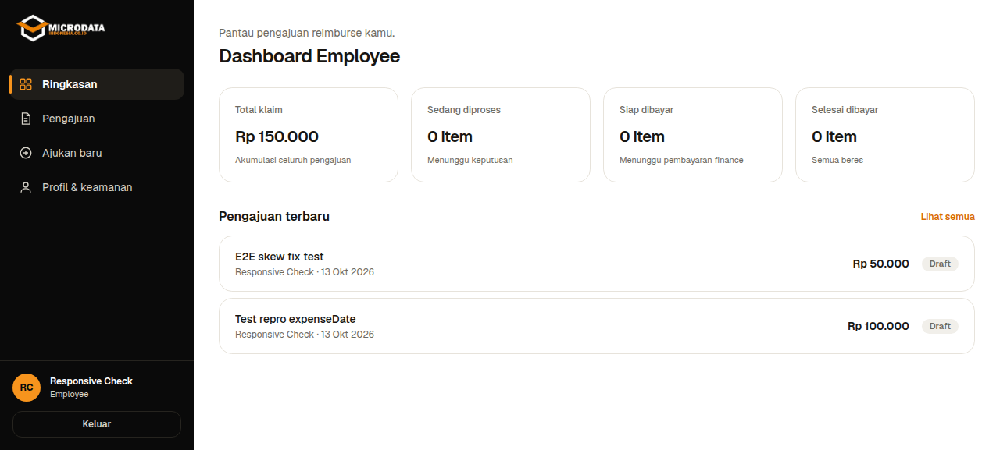
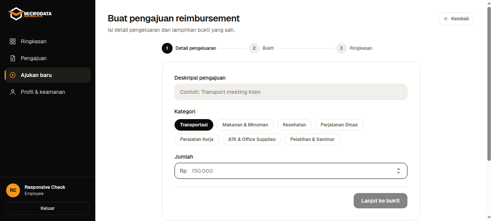
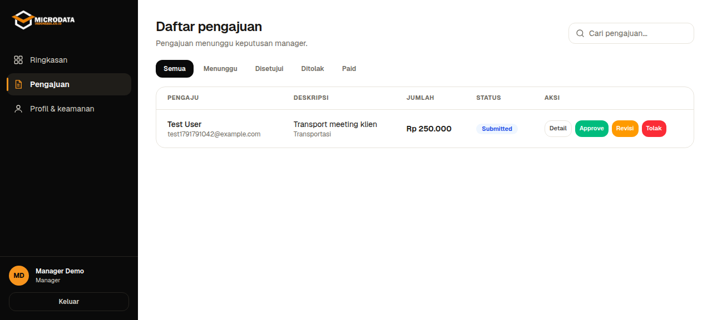
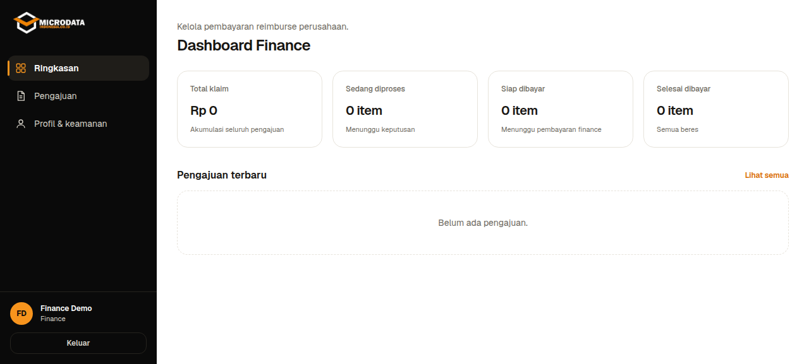
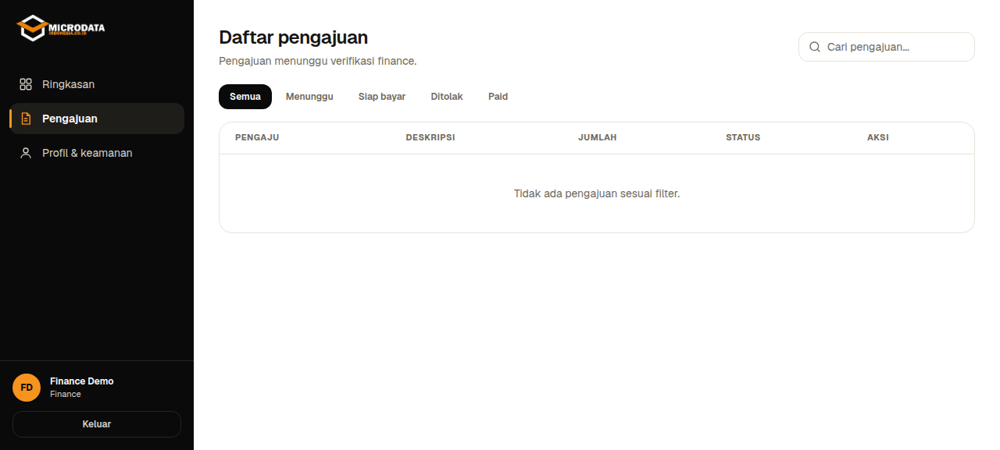

# Reimbursement Management System

Aplikasi web untuk mengelola pengajuan reimbursement karyawan dari pembuatan klaim sampai pembayaran. Sistem menyediakan dashboard sesuai role, alur persetujuan bertahap, pencatatan aktivitas, dan dokumentasi REST API.

## Screenshots

### Halaman Login


### Dashboard Employee


### Buat Pengajuan Baru


### Review Manager


### Dashboard Finance


### Verifikasi Finance


## Fitur utama

- Employee membuat reimbursement, menambahkan expense, mengunggah bukti, lalu mengirim pengajuan.
- Manager meninjau pengajuan dan dapat menyetujui, menolak, atau meminta revisi.
- Finance memverifikasi pengajuan yang disetujui manager dan memproses pembayaran.
- Sistem mencatat perubahan status, menyediakan notifikasi, audit log, dan ringkasan laporan.
- Swagger UI menyediakan dokumentasi endpoint dan fasilitas untuk mencoba API.

## Role dan alur reimbursement

Role yang tersedia adalah `EMPLOYEE`, `MANAGER`, dan `FINANCE`.

```text
DRAFT -> SUBMITTED -> MANAGER_APPROVED -> FINANCE_REVIEW
FINANCE_REVIEW -> READY_FOR_PAYMENT -> PAID
```

Pengajuan dapat masuk ke status `REVISION_REQUIRED` atau `REJECTED` selama proses review. Employee melengkapi revisi dan mengirim ulang pengajuan.

## Teknologi

- Frontend: Next.js App Router, React, TypeScript, Tailwind CSS.
- Backend: Node.js, Express, TypeScript, Prisma, PostgreSQL.
- Storage bukti: MinIO (S3-compatible).
- API documentation: OpenAPI dan Swagger UI.

## Menjalankan dengan Docker (disarankan)

Cara tercepat menjalankan seluruh stack (database, MinIO, backend, frontend):

```bash
cp .env.example .env   # jika ada; atau buat .env dengan GOOGLE_CLIENT_ID, GOOGLE_CLIENT_SECRET, GOOGLE_REDIRECT_URI, APP_URL
docker compose up -d --build
```

Service yang berjalan:

| Service | URL |
|---|---|
| Frontend | http://localhost:3000 |
| Backend API | http://localhost:3001 |
| Swagger UI | http://localhost:3001/api-docs |
| MinIO S3 API | http://localhost:9000 |
| MinIO Console | http://localhost:9001 (minioadmin/minioadmin) |
| PostgreSQL | localhost:5433 (postgres/postgres) |

Bukti/receipt yang diunggah otomatis tersimpan di bucket MinIO `receipts` (public read).

## Struktur repository

```text
reimbursement/
├── docker-compose.yml          # Stack lengkap: db, minio, backend, frontend
├── docs/screenshots/           # Screenshot aplikasi untuk README
├── backend/
│   ├── Dockerfile
│   ├── prisma/                 # Prisma schema dan database migrations
│   ├── src/
│   │   ├── controllers/        # Handler request/response API
│   │   ├── docs/openapi.ts     # Spesifikasi OpenAPI untuk Swagger UI
│   │   ├── middleware/         # Autentikasi, otorisasi, dan upload ke MinIO
│   │   ├── models/             # Akses data
│   │   ├── routes/             # Registrasi endpoint Express
│   │   ├── services/           # Aturan bisnis
│   │   └── views/              # Format response API
│   └── README.md               # Setup backend dan dokumentasi API
└── frontend/
    ├── Dockerfile
    ├── app/
    │   ├── actions/            # Pemanggilan REST API backend
    │   ├── api/auth/           # Proxy autentikasi ke backend
    │   └── components/         # Dashboard dan komponen aplikasi
    ├── components/ui/          # Komponen UI bersama
    ├── lib/                    # Auth, utilitas, dan koneksi database
    ├── public/                 # Aset statis
    └── README.md               # Setup frontend
```

## Menjalankan tanpa Docker (development)

Frontend dan backend dijalankan di terminal terpisah. Pastikan PostgreSQL aktif dan buat konfigurasi `backend/.env` sebelum menjalankan backend. Gunakan konfigurasi pada [README backend](backend/README.md); URL database, JWT secret, port, dan origin frontend harus disesuaikan dengan mesin lokal.

Terminal 1, jalankan backend:

```bash
cd backend
npm install
npm run prisma:generate
npm run prisma:migrate
npm run dev
```

Backend berjalan secara default di [http://localhost:3001](http://localhost:3001). Dokumentasi API tersedia di [http://localhost:3001/api-docs](http://localhost:3001/api-docs).

Terminal 2, jalankan frontend:

```bash
cd frontend
npm ci
npm run dev
```

Frontend berjalan di [http://localhost:3000](http://localhost:3000) dan menggunakan API backend di `http://localhost:3001/api` secara default. Detail konfigurasi, build produksi, dan troubleshooting tersedia di [README frontend](frontend/README.md).

## Dokumentasi API

Buka `http://localhost:3001/api-docs` saat backend berjalan. Endpoint yang membutuhkan autentikasi memakai JWT Bearer token. Login melalui `POST /api/auth/login`, lalu gunakan nilai `token` melalui tombol **Authorize** di Swagger UI.

## Catatan konfigurasi

- Jangan commit file `backend/.env` dan `.env` root; keduanya berisi konfigurasi lokal dan rahasia.
- Jika backend berjalan di port lain, perbarui `NEXT_PUBLIC_API_URL` di `frontend/.env.local` dan `BACKEND_URL` pada `frontend/next.config.mjs`.
- Setup rinci tiap aplikasi tersedia di [README backend](backend/README.md) dan [README frontend](frontend/README.md).
